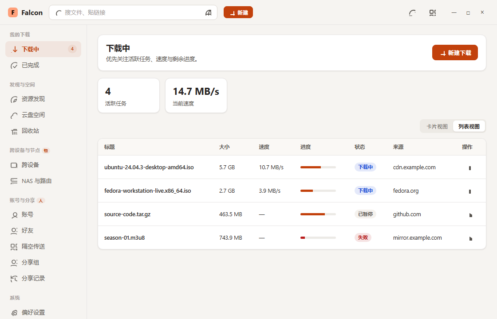

[中文](zh/README.md) | **English**

# Falcon Documentation

`docs/` **is** the VitePress project root: documentation sources live directly here, with `.vitepress/` at the root. There is no intermediate `src/` directory. The Chinese maintenance notes live at [`zh/README.md`](zh/README.md); the language homepage is [`zh/index.md`](zh/index.md). `README.md` and `zh/README.md` are repository notes and are excluded from the site build.

> The docs cover a single module — **Core** — `guide/`, `protocols/`, `api/`, `developer/`, `faq.md`: how the code actually works.
>
> Desktop UI design is maintained as a static prototype under `design/ui-next/` with exported screenshots in `public/design/ui-next/screens/`; it is not a documentation module.

## Documentation map

| Area | Repository source | Published site |
|------|-------------------|----------------|
| User guide | [`guide/`](guide/) | [Guide](https://cuihairu.github.io/falcon/guide/) |
| Protocols | [`protocols/`](protocols/) | [Protocols](https://cuihairu.github.io/falcon/protocols/) |
| API reference | [`api/`](api/) | [API](https://cuihairu.github.io/falcon/api/) |
| Developer docs | [`developer/`](developer/) | [Developer](https://cuihairu.github.io/falcon/developer/) |
| Interactive prototype | [`design/ui-next/index.html`](design/ui-next/index.html) | — (open the HTML file locally) |
| Chinese docs | [`zh/`](zh/) | [中文文档](https://cuihairu.github.io/falcon/zh/) |
| Chinese notes | [`zh/README.md`](zh/README.md) | — (excluded from build) |

Published URLs use the `/falcon/` base when deployed to GitHub Pages; relative links in this file are for browsing the repository on GitHub.

## Quick Start

### Install dependencies

```bash
cd docs
pnpm install
```

### Development mode

```bash
pnpm docs:dev
```

Open the local address printed in the terminal.

### Build the docs

```bash
pnpm docs:build
```

The build output is written to `docs/.vitepress/dist/`.

## Current design

The only maintained desktop design is [`design/ui-next/`](design/ui-next/): a static interactive prototype with 25 screens. Exported screenshots live in [`public/design/ui-next/screens/`](public/design/ui-next/screens/) — 3 accent themes × light/dark × 25 screens = 150 PNGs; all design images in the docs reference this folder.



The prototype's authoring notes and design decisions are in [`design/ui-next/README.zh.md`](design/ui-next/README.zh.md).

## Documentation Structure

```
docs/
├── .vitepress/               # VitePress configuration
│   ├── config.mts            # Main config (nav, sidebar, locales, base)
│   └── theme/                # Custom theme and carousel
├── public/                   # Static assets
│   ├── logo.svg / favicon.svg
│   └── design/ui-next/screens/  # 150 exported design images
├── index.md                  # English home page
├── faq.md                    # English FAQ
├── guide/                    # Core · user guide
├── protocols/                # Core · protocol docs
├── api/                      # Core · API reference (incl. low-level utilities)
├── developer/                # Core · architecture, P2SP, MCP, packaging, testing
├── design/ui-next/           # Interactive UI prototype (25 screens)
├── README.md                 # English repository notes (not published)
└── zh/                       # 简体中文（镜像上述结构）
    ├── index.md              # Chinese home page
    ├── README.md             # Chinese repository notes (not published)
    ├── guide/ protocols/ api/ developer/
    └── faq.md
├── package.json / pnpm-lock.yaml
└── pnpm-workspace.yaml
```

Content pages are split by language: `name.md` is English, `zh/name.md` is the Chinese counterpart.

## VitePress Components

### Callouts

```markdown
::: tip Tip
This is a tip.
:::

::: warning Warning
This is a warning.
:::

::: danger Danger
This is a danger callout.
:::
```

### Custom containers

```md
::: details Click to view details
Hidden content
:::
```

## Deployment

### GitHub Pages (manual fallback — production deploys via `.github/workflows/docs-deploy.yml`)

```bash
pnpm docs:build
cd .vitepress/dist
git init
git add .
git commit -m "Deploy docs"
git push -f git@github.com:cuihairu/falcon.git main:gh-pages
```

### Vercel/Netlify

```bash
cd docs && pnpm install --frozen-lockfile && pnpm docs:build
```

Set the publish directory to `docs/.vitepress/dist`.

### GitHub Actions

- Repository-root `.github/workflows/docs-deploy.yml` — builds and deploys on push to `main`
- Repository-root `.github/workflows/docs-check.yml` — independent build validation on PR / push

Both install with `pnpm` and upload `docs/.vitepress/dist`; `base` is derived from the repository name.

## Learn More

- [VitePress documentation](https://vitepress.dev/)
