# Falcon 桌面 UI 重设计提案 · 三方向对比（2026-11）

桌面 UI 重设计（UI-RD-001）的原型交付页。**铁律：只做原型，不改生产代码**——所有渲染由 ui_sandbox
离屏管线产出（真实 Qt 组件树 + 演示任务数据，零引擎/网络副作用），生产 `theme_tokens.hpp` /
`fluent_*.qss` 零改动。用户拍板方向后才排实现批次（届时只需把对应方向 token 写入生产 QSS/QPalette）。

- **规模**：3 方向 × 14 功能面 × 亮/暗双主题 = **84 张原型图**（每方向 28 张）
- **方法**：纯 token 换肤——三方向与生产的组件树/布局/间距/交互完全一致，只有 QSS 内 hex 值（连同重建
  的 QPalette）不同；checkbox SVG 按各方向色重生成；托盘菜单（第 14 个功能面，本矩阵新增）自动继承
  方向色板
- **共同边界**：顶栏 falcon logo 保持品牌鲑橙 `#ffa07a`（烧在品牌 SVG 里，有意保留的锚点）；`rgba(...)`
  叠加 token 沿用生产值；图标着色经 `tokens_for()` 取生产值

## 三方向总览

| | A · warm console II | B · cold utility II | C · graphite emerald |
|---|---|---|---|
| 定位 | 现行方向的迭代精修 | 冷色工具风（对标 Motrix） | 全新品牌身份 |
| 中性底 | 暖黑（延续生产家族） | 冷深蓝黑 | 近黑石墨 |
| accent | falcon 橙家族不变 | 克制蓝 `#5b9df5` | 祖母绿 `#34d399` |
| 暗色 text 对比 | 16.73:1 | **17.03:1**（三者最高） | 16.65:1 |
| 暗色 accent 于窗底 | 9.37:1 | 6.60:1 | **9.78:1**（三者最高） |
| 与品牌橙的距离 | 零（同家族） | 最远 | 远（且要求双色共存顶栏） |
| 改动量 / 评审风险 | 最小 / 最低 | 中 / 中 | 最大 / 最高 |
| 详页 | [warm/README.md](warm/README.zh.md) | [cold/README.md](cold/README.zh.md) | [graphite/README.md](graphite/README.zh.md) |

全部对比度经 Python 实算（WCAG AA），每方向 24 对色检查全部 ≥ 4.5:1。

## 关键视图并排（暗色 · 下载页表格视图）

| A warm II | B cold II | C graphite |
|---|---|---|
| 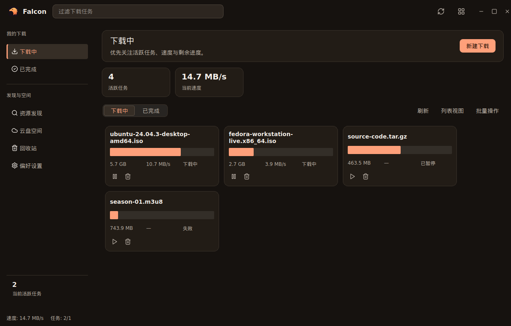 | 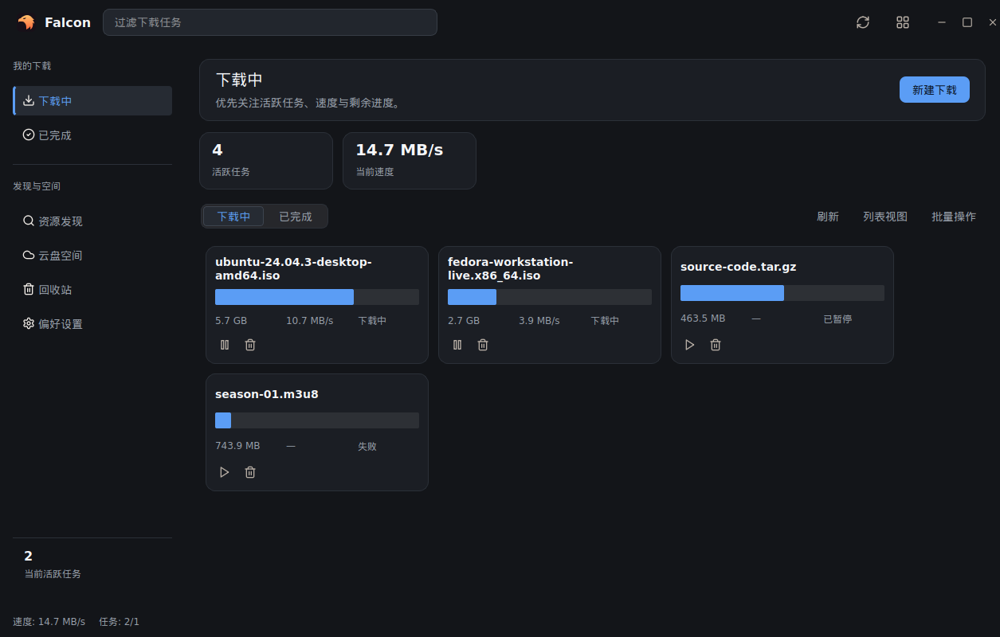 | 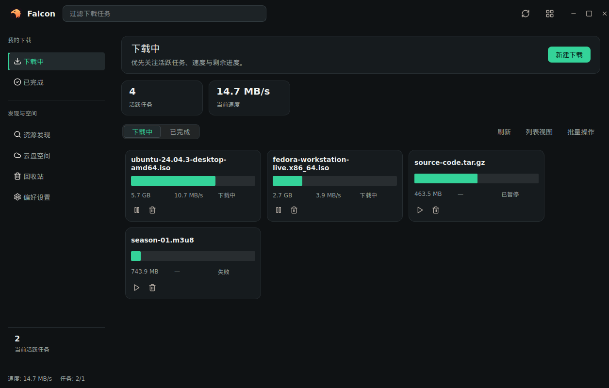 |

## 关键视图并排（亮色 · 下载页表格视图）

| A warm II | B cold II | C graphite |
|---|---|---|
| 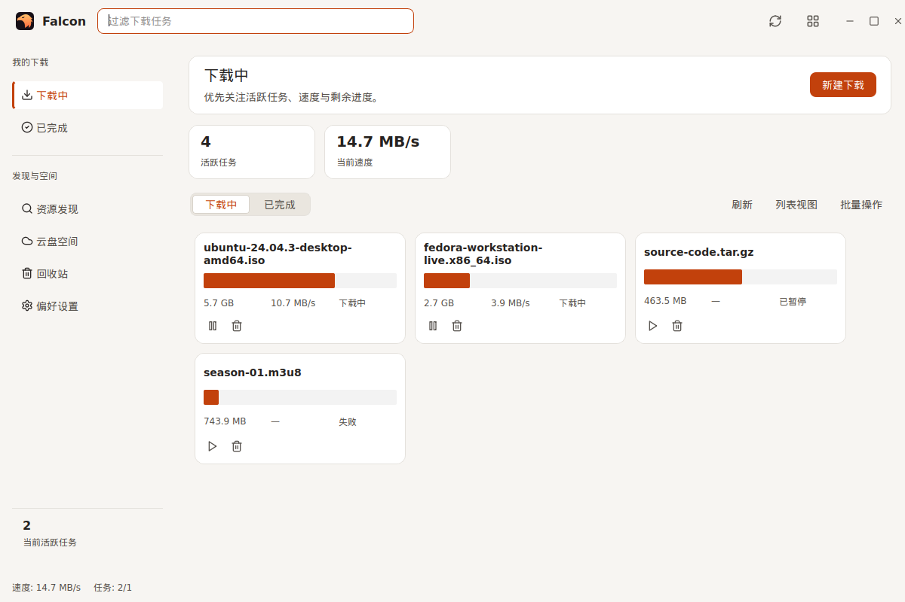 | 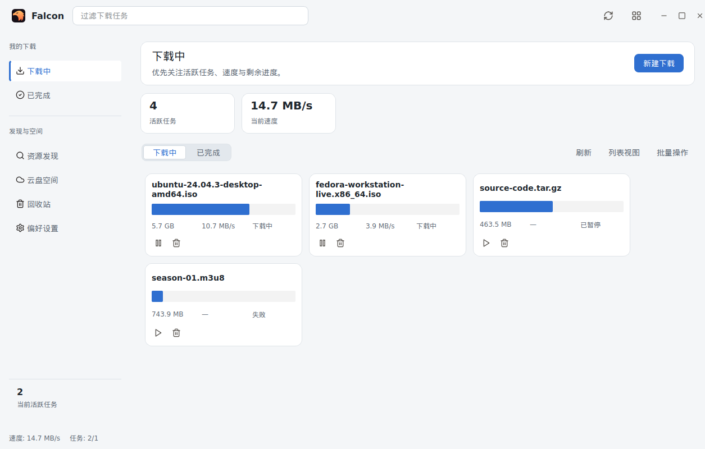 | 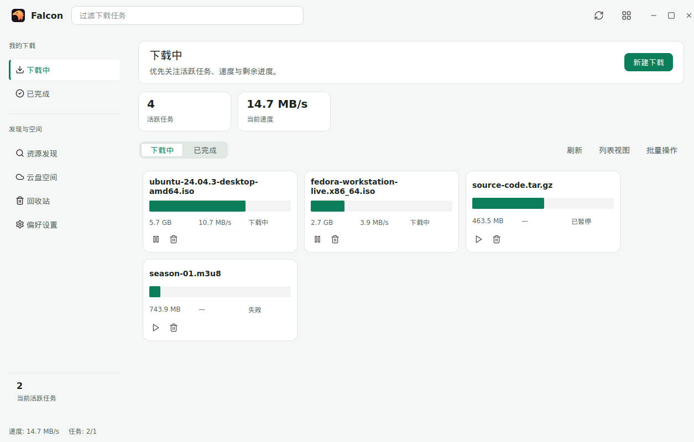 |

设置页（暗色）：

| A warm II | B cold II | C graphite |
|---|---|---|
| 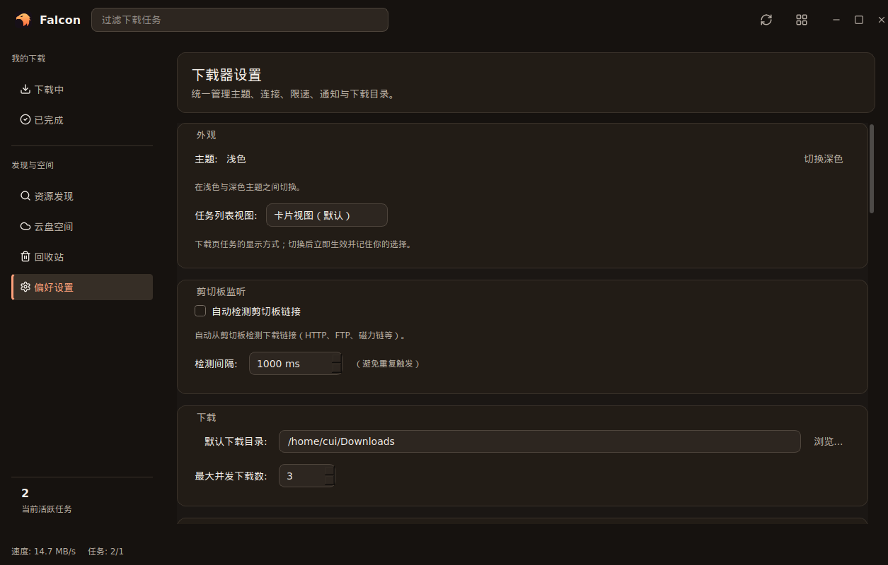 | 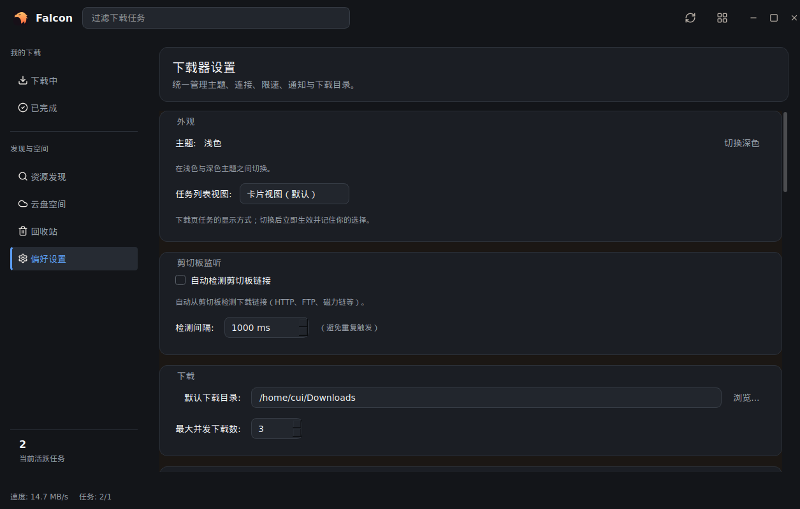 | 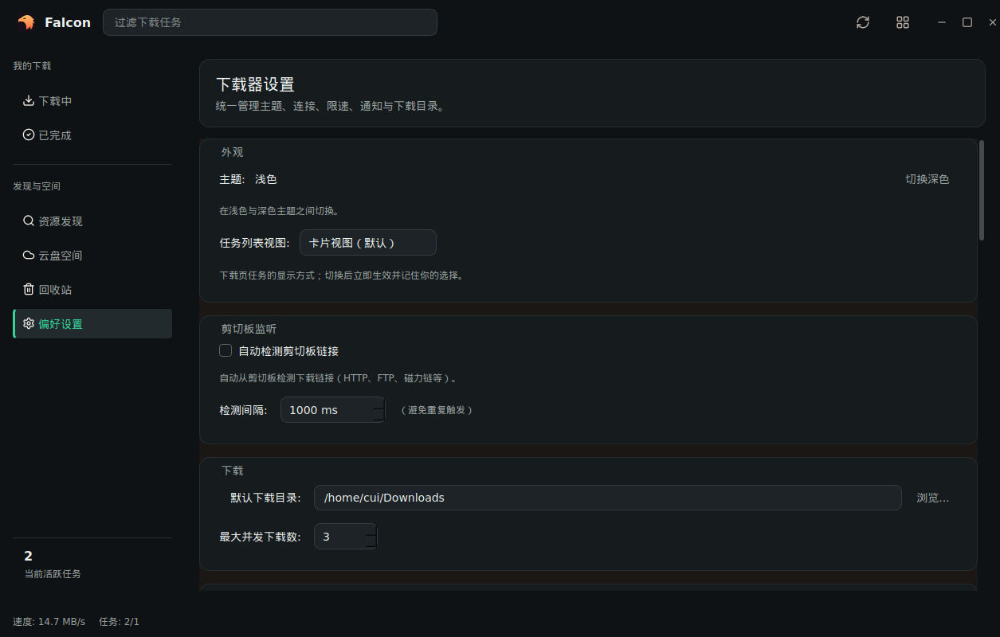 |

添加对话框（暗色）：

| A warm II | B cold II | C graphite |
|---|---|---|
| 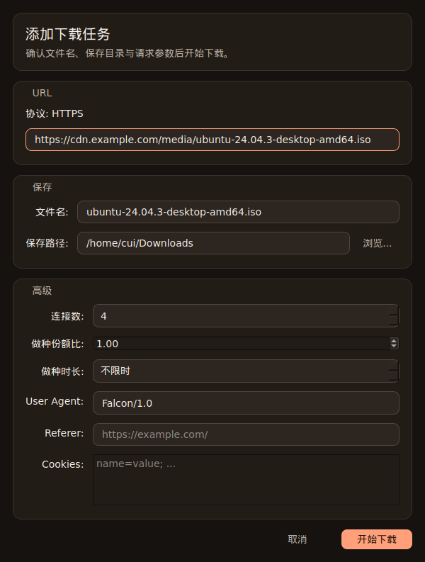 | 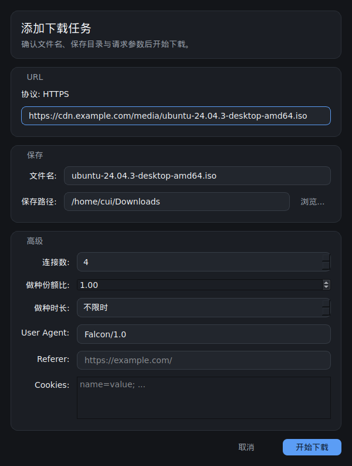 | 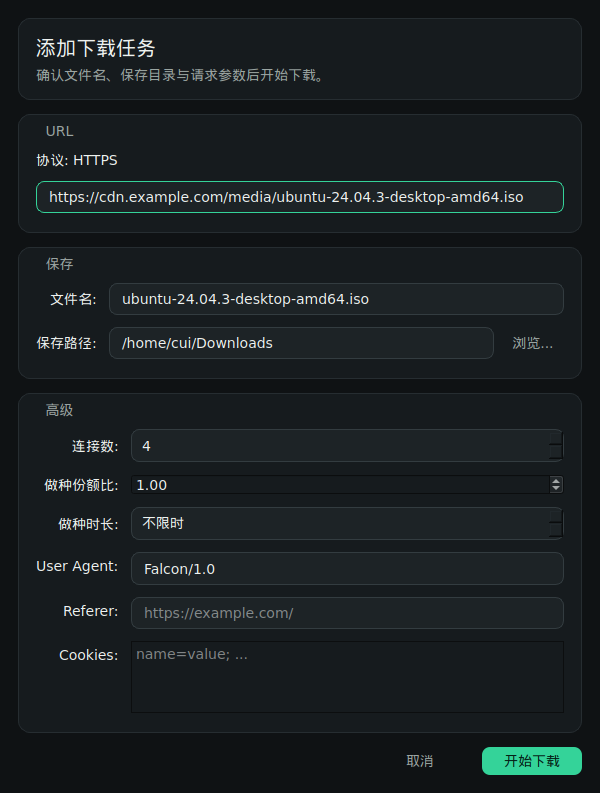 |

全部 84 张图见各方向目录（`<face>_<slug>_{dark,light}.png`）。

## 各方向取舍

### A · warm console II（warm/）

- **Pro**：最安全——与今日线上形态近乎一致，评审风险最小、增量易于审计；与文档站保持完整品牌连续性。
- **Con**：变革性最低，单位投入产出的可感知变化最少。
- 适合：用户主要想要「更精修的现行方向」而非「新身份」。

### B · cold utility II（cold/）

- **Pro**：文字对比度三者最高（暗色 17.03:1）、accent 最克制（蓝读作「工具」而非「媒体」）、中性底最深
  ——最接近 power tool 气质。暗色板逐字沿用 2026-09-29 已评审过的原型（`kColdHexMap`）。
- **Con**：与品牌橙距离最远，logo 鲑橙与其余全蓝是三者中最大的风格张力。亮色面为全新设计（此前原型只有
  暗色）。
- 适合：用户想要「专业下载工具」的冷峻气质，且能接受品牌锚点与主体色的张力。

### C · graphite emerald（graphite/）

- **Pro**：唯一真正建立新桌面身份的方向；最深窗底 `#0f1214` + 最高 accent 于窗底对比度 9.78:1。
- **Con**：品牌断裂最大——logo 鲑橙与祖母绿强调必须在顶栏共存，最可能因品牌原因被否；近黑 + 绿有读作
  「泛用 dev tool」的风险。
- 适合：用户想要明确区别于现状的新身份，且愿意为身份感承担品牌风险。

## 拍板参考

- 要**品牌延续 + 低风险** → A；要**工具感 + 对比度** → B；要**新身份** → C。
- 拍板后的实现批次成本三方向相同（纯 token 落地：把方向映射表写入生产 `theme_tokens.hpp` +
  双 QSS，重生成 checkbox SVG），差异只在评审接受度。
- 混合方案可行（token 体系是单点）：如「A 的中性底 + C 的 accent」，但需重跑对比度验算。

## 文件布局

```
redesign-2026-11/
├── index.md                  # 本页（对比 + 决策）
├── warm/                     # 方向 A：28 PNG + README.md / README.zh.md + assets/
├── cold/                     # 方向 B：28 PNG + README.md / README.zh.md + assets/
└── graphite/                 # 方向 C：28 PNG + README.md / README.zh.md + assets/
```

14 个功能面：add_dialog / cloud / discovery / download_table / download_grid /
download_completed / download_completed_grid / settings / settings_search / settings_seeding /
settings_trash / settings_about / trash / tray_menu。

> 功能面命名说明：`download_table_*` 实际显示**网格卡片**视图、`download_grid_*` 显示**表格**——生产
> 默认是 `TaskDisplayStyle::Grid`（`download_page.cpp:82`），沙盒在 `toggle_display_style()` 前后各截
> 一张；命名沿用已入库的 `docs/design/ui-sandbox` 矩阵惯例。

## 重新生成

```bash
cmake --build build-ui-audit --target falcon-ui-sandbox
build-ui-audit/bin/falcon-ui-sandbox --redesign docs/design/redesign-2026-11
```

（需要以 `FALCON_BUILD_UI_SANDBOX=ON` 配置的构建树 + 系统 Qt6；离屏渲染，无需显示环境。`--redesign`
模式新增于 `apps/desktop/dev/ui_sandbox.cpp`，只触碰沙盒会话。）
