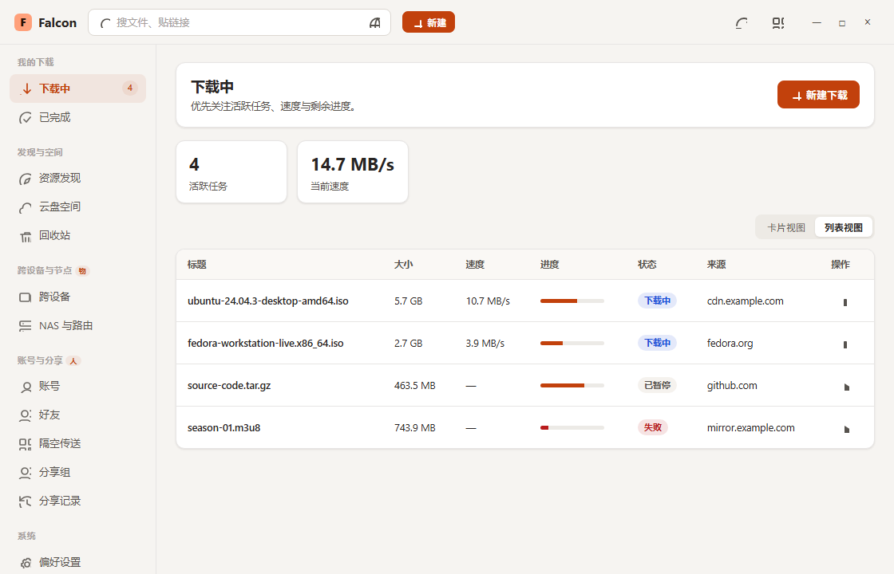

[English](../README.md) | **简体中文**

# Falcon 文档

`docs/` **就是** VitePress 项目根：文档源文件直接位于 `docs/`，`.vitepress/` 也在该目录，不再有中间的 `src/` 目录。本文件是中文维护说明，规范位置为 `docs/zh/README.md`；中文站点首页是 [`docs/zh/index.md`](index.md)。`docs/README.md` 与 `docs/zh/README.md` 都不参与站点构建。

> 文档分为两个顶层模块：
> - **核心** —— `guide/`、`protocols/`、`api/`、`developer/`、`faq.md`：代码实际如何工作。
> - **UI 设计** —— `ui/`：桌面界面应该如何呈现与交互。
>
> 旧草稿与时效性快照中仍有价值的已合并，其余删除；历史内容见 git 记录。

## 文档导航

| 区域 | 仓库源文件（相对本文件） | 线上地址 |
|------|--------------------------|----------|
| 用户指南 | [`../guide/`](../guide/) | [指南](https://cuihairu.github.io/falcon/zh/guide/) |
| 协议 | [`../protocols/`](../protocols/) | [协议](https://cuihairu.github.io/falcon/zh/protocols/) |
| API 参考 | [`../api/`](../api/) | [API](https://cuihairu.github.io/falcon/zh/api/) |
| 开发者 | [`../developer/`](../developer/) | [开发者](https://cuihairu.github.io/falcon/zh/developer/) |
| UI 设计 | [`ui/`](ui/) | [UI 设计](https://cuihairu.github.io/falcon/zh/ui/) |
| UI 设计规范 | [`ui/design-spec.md`](ui/design-spec.md) | [设计规范](https://cuihairu.github.io/falcon/zh/ui/design-spec) |
| 交互原型 | [`../design/ui-next/index.html`](../design/ui-next/index.html) | —（本地打开 HTML） |
| 英文维护说明 | [`../README.md`](../README.md) | —（不参与构建） |

线上地址使用 GitHub Pages 的 `/falcon/` base；本文件中的相对链接用于 GitHub 仓库浏览。

## 快速开始

### 安装依赖

```bash
cd docs
pnpm install
```

### 开发模式

```bash
pnpm docs:dev
```

访问终端输出中的本地地址。

### 构建文档

```bash
pnpm docs:build
```

构建产物位于 `docs/.vitepress/dist/`。

## 当前设计稿

当前唯一维护的桌面设计是 [`../design/ui-next/`](../design/ui-next/)：一个 24 屏静态交互原型。导出图位于 [`../public/design/ui-next/screens/`](../public/design/ui-next/screens/)：3 主题色 × 亮暗 × 24 屏 = 144 张 PNG，文档中的设计图统一引用这里。



完整说明已发布为 [UI 设计规范](ui/design-spec.md)，包含账号与分享、隔空传送、LocalSend / AirDrop / DHT 取舍与 Windows 托盘。原型审查说明见 [`../design/ui-next/README.zh.md`](../design/ui-next/README.zh.md)。

## 文档结构

```
docs/
├── .vitepress/               # VitePress 配置
│   ├── config.mts            # 主配置（导航、侧栏、语言、base）
│   └── theme/                # 自定义主题与走马灯
├── public/                   # 静态资源
│   ├── logo.svg / favicon.svg
│   └── design/ui-next/screens/  # 144 张设计图
├── index.md                  # 英文首页
├── faq.md                    # 英文常见问题
├── guide/                    # 核心 · 用户指南
├── protocols/                # 核心 · 协议文档
├── api/                      # 核心 · API 参考（含底层工具）
├── developer/                # 核心 · 架构、P2SP、MCP、打包、测试
├── ui/                       # UI 设计 · 规范、重设计、原型
├── design/ui-next/           # 24 屏交互原型
├── README.md                 # 英文维护说明（不参与构建）
├── package.json / pnpm-lock.yaml
├── pnpm-workspace.yaml
└── zh/                       # 简体中文（镜像上述结构）
    ├── index.md              # 中文站点首页
    ├── README.md             # 本文件（不参与构建）
    ├── faq.md
    ├── guide/ protocols/ api/ developer/ ui/
    └── README.md 之外的内容页按英文结构镜像
```

内容页按语言分文件：英文为 `docs/name.md`，中文为 `docs/zh/name.md`；`README.md` 属于仓库维护说明，不是站点页面。

## VitePress 组件

### 提示框

```markdown
::: tip 提示
这是一个提示
:::

::: warning 注意
这是一个警告
:::

::: danger 危险
这是一个危险提示
:::
```

### 自定义容器

```md
::: details 点击查看详情
隐藏的内容
:::
```

## 部署

### GitHub Pages（备用：手动发布——正式发布走 `.github/workflows/docs-deploy.yml`）

```bash
pnpm docs:build
cd .vitepress/dist
git init
git add .
git commit -m "Deploy docs"
git push -f git@github.com:cuihairu/falcon.git main:gh-pages
```

### Vercel/Netlify

```bash
cd docs && pnpm install --frozen-lockfile && pnpm docs:build
```

发布目录设为 `docs/.vitepress/dist`。

### GitHub Actions

- 仓库根目录 `.github/workflows/docs-deploy.yml` —— push 到 `main` 时自动构建并部署
- 仓库根目录 `.github/workflows/docs-check.yml` —— PR / push 时独立构建校验

两者均用 `pnpm` 安装并上传 `docs/.vitepress/dist`；`base` 由仓库名自动推导。

## 更多信息

- [VitePress 官方文档](https://vitepress.dev/)
